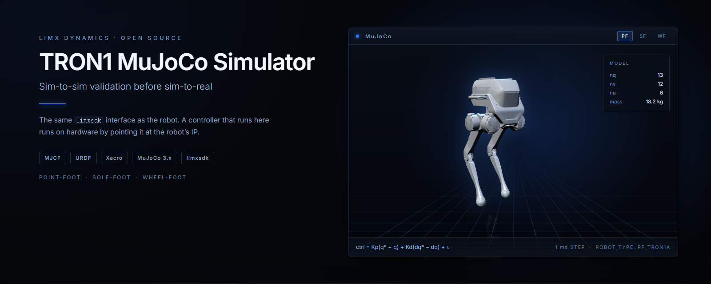
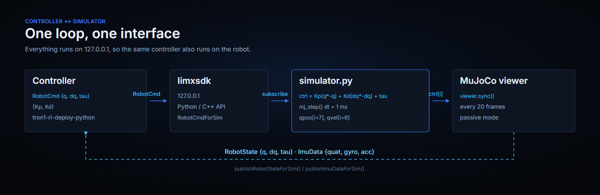
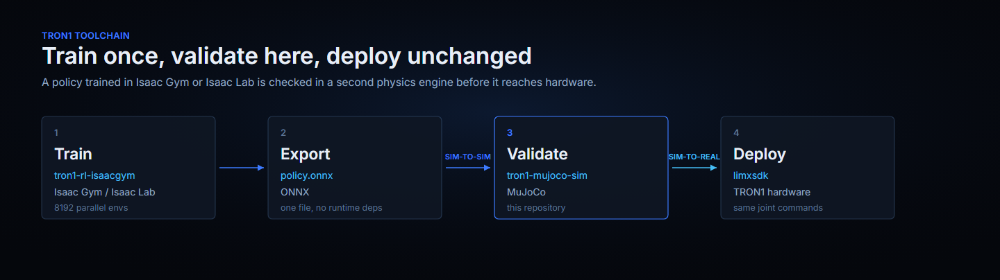

<p align="center">
  
</p>

<p align="center">
  <b>English</b> | <a href="README_cn.md">中文</a>
</p>

<p align="center">
  <a href="LICENSE"></a>
  
  
  
</p>

# TRON1 MuJoCo Simulator

Run the official TRON1 controllers and RL policies in MuJoCo, against the same
`limxsdk` interface the robot exposes. A controller pointed at `127.0.0.1`
drives this simulator; pointed at the robot's IP it drives the robot, unchanged.

**Scope.** This repository simulates and validates controllers. It does not train
policies — training lives in [tron1-rl-isaacgym](https://github.com/limxdynamics/tron1-rl-isaacgym)
and [tron1-rl-isaaclab](https://github.com/limxdynamics/tron1-rl-isaaclab).

## Highlights

- **Sim-to-sim before sim-to-real.** Re-check a policy trained in Isaac Gym or
  Isaac Lab in a second physics engine before it touches hardware.
- **Interchangeable with the robot.** The simulator publishes `RobotState` and
  `ImuData` and consumes `RobotCmd` through `limxsdk`, exactly like TRON1.
- **Ten configurations, one code path.** Six point-foot, two sole-foot and two
  wheel-foot models, including the TRON1B variants, selected with `ROBOT_TYPE`.
- **Actuator-level control.** Every joint is driven by a PD law evaluated on a
  1 ms MuJoCo step, so gains that work here transfer to the robot.
- **Keyboard driving built in.** The bundled virtual joystick walks and turns the
  robot without a gamepad.

## Models

Each card is rendered from that model's MJCF in
[robot-description](https://github.com/limxdynamics/tron1-robot-description), the
submodule this repository simulates. Joint counts and masses are read from the
compiled MuJoCo models.

| Rendering | Configuration | Description | Joints | Format |
|:--:|---|---|:--:|---|
|  | **Point-foot** | Ball feet, six actuated joints. The default configuration for controller work. | 6 | MJCF / URDF / Xacro |
|  | **Sole-foot** | Flat feet on parallel-linkage ankles. Two extra ankle joints to balance. | 8 | MJCF / URDF / Xacro |
|  | **Wheel-foot** | Driven wheels instead of feet. Needs a real-time machine; see Troubleshooting. | 8 | MJCF / URDF / Xacro |

`ROBOT_TYPE` selects the configuration. Every value below is a directory under
`robot-description/pointfoot/`, and the simulator loads
`<ROBOT_TYPE>/xml/robot.xml` from it.

| `ROBOT_TYPE` | Configuration | Joints | Mass |
|---|:--:|:--:|--:|
| `PF_TRON1A`, `PF_TRON1B` | Point-foot | 6 | 18.2 kg |
| `SF_TRON1A`, `SF_TRON1B` | Sole-foot | 8 | 20.8 kg |
| `WF_TRON1A`, `WF_TRON1B` | Wheel-foot | 8 | 22.3 kg |
| `PF_P441A` | Point-foot (P441) | 6 | 18.5 kg |
| `PF_P441B` | Point-foot (P441) | 6 | 17.2 kg |
| `PF_P441C`, `PF_P441C2` | Point-foot (P441) | 6 | 18.8 kg / 18.4 kg |

## How it works

The simulator is one process that owns the physics loop and nothing else. Your
controller stays a normal `limxsdk` client, so the same binary runs here and on
the robot.

<p align="center">
  
</p>

Where this repository sits in the TRON1 toolchain:

<p align="center">
  
</p>

## Quick start: view a model in 30 seconds

The models are plain MJCF. They load in MuJoCo on any OS with no SDK, no ROS and
no Linux:

```bash
pip install mujoco
git clone --depth 1 https://github.com/limxdynamics/tron1-robot-description.git
python -m mujoco.viewer --mjcf=tron1-robot-description/pointfoot/PF_TRON1A/xml/robot.xml
```

Nothing is controlling the robot, so it drops to the floor. That is the correct
behaviour — the next section attaches a controller.

## Requirements

- **Linux on x86_64 or aarch64.** The full simulator path below is built and
  tested there. macOS is not supported.
- **Python 3.8.** The `limxsdk` wheels are CPython 3.8 builds — the Linux
  extension links `libpython3.8.so.1.0`, the Windows one links `python38.dll` —
  even though both files are tagged `py3-none-any`. Installing them on a newer
  interpreter succeeds; importing does not.
- MuJoCo and the other Python dependencies are installed together with
  `limxsdk`.
- The virtual joystick is x86_64 only.

`limxsdk-lowlevel/python3/win` also ships a `limxsdk-3.4.0` wheel and
`robot-joystick` ships `robot-joystick.exe`, both x86_64. The steps below do not
cover those two paths, and the Windows wheel is one minor version behind the
Linux one (3.4.0 vs 3.4.2). The models themselves have none of these
constraints — see the 30-second quick start above.

## Run an RL policy in the simulator

**1. Clone the simulator and the RL controller** (submodules are required):

```bash
git clone --recurse-submodules https://github.com/limxdynamics/tron1-mujoco-sim.git
git clone --recurse-submodules https://github.com/limxdynamics/tron1-rl-deploy-python.git
```

**2. Install `limxsdk` in a virtual environment.** On Ubuntu 23.04 and later a
plain `pip install` outside a virtual environment is refused
(`externally-managed-environment`).

```bash
sudo apt install -y python3-venv      # if venv is not installed yet
python3 -m venv ~/tron1-venv
source ~/tron1-venv/bin/activate

# Linux x86_64
pip install tron1-mujoco-sim/limxsdk-lowlevel/python3/amd64/limxsdk-*.whl
# Linux aarch64
# pip install tron1-mujoco-sim/limxsdk-lowlevel/python3/aarch64/limxsdk-*.whl
```

**3. Start the simulator** (terminal 1):

```bash
source ~/tron1-venv/bin/activate
export ROBOT_TYPE=PF_TRON1A           # see "Models"
python tron1-mujoco-sim/simulator.py
```

The robot falls over right away — nothing is controlling it yet.

**4. Start the RL controller** (terminal 2):

```bash
source ~/tron1-venv/bin/activate
export ROBOT_TYPE=PF_TRON1A           # must match the simulator
export RL_TYPE=isaacgym               # or isaaclab
python tron1-rl-deploy-python/main.py
```

**5. Reset the robot:** click the MuJoCo window and press **Backspace**. The robot
stands up under the policy's control.

<p align="center">
  
  <br>
  <sub>Point-foot, sole-foot and wheel-foot TRON1 running the official RL policies in MuJoCo (rendered offscreen with a custom scene).</sub>
</p>

## Drive it with the virtual joystick

**6.** In a third terminal:

```bash
./tron1-mujoco-sim/robot-joystick/robot-joystick
```

With the joystick window focused, use the **arrow keys** to walk and **Numpad 4 /
6** to turn. All key bindings are listed in the joystick window.

<p align="center">
  
</p>

To make `ROBOT_TYPE` permanent, add the `export` line to `~/.bashrc`.

## Run the C++ SDK example

The `limxsdk-lowlevel` submodule includes C++ examples that talk to the simulator
the same way.

```bash
sudo apt update
sudo apt install -y cmake build-essential libeigen3-dev

cd tron1-mujoco-sim/limxsdk-lowlevel
mkdir -p build && cd build
cmake .. && make

export ROBOT_TYPE=PF_TRON1A           # same as the simulator
./examples/pf_groupJoints_move
```

`pf_groupJoints_move` is a point-foot example: it moves every joint smoothly to
the zero position and does not balance the robot.

## Use your own controller

The simulator connects to `127.0.0.1` through `limxsdk`. Any controller that
subscribes to `RobotState` / `ImuData` and publishes `RobotCmd` with `limxsdk`
works — see [tron1-rl-deploy-python](https://github.com/limxdynamics/tron1-rl-deploy-python)
for a complete Python example and the
[limxsdk-lowlevel](https://github.com/limxdynamics/limxsdk-lowlevel) examples for C++.

## Troubleshooting

- **The robot lies on the floor.** Start the controller first, then press
  Backspace in the MuJoCo window.
- **`error: externally-managed-environment`.** Install into a virtual environment
  as shown above.
- **`Please set the ROBOT_TYPE`.** Every terminal (simulator, controller, SDK
  examples) needs `export ROBOT_TYPE=...`.
- **Wheel-foot falls on a slow machine or VM.** The controller runs on wall-clock
  time. If the simulator runs slower than real time (for example in a VM with
  software rendering), wheel-foot balance suffers first; use a machine with
  GPU-accelerated OpenGL.

## Related repositories

TRON1 is split across several repositories. This one is the sim-to-sim step:

| Repository | Description |
|---|---|
| [tron1-rl-isaacgym](https://github.com/limxdynamics/tron1-rl-isaacgym) | Train TRON1 RL policies in Isaac Gym |
| [tron1-rl-isaaclab](https://github.com/limxdynamics/tron1-rl-isaaclab) | Train TRON1 RL policies in Isaac Lab |
| [tron1-rl-deploy-python](https://github.com/limxdynamics/tron1-rl-deploy-python) | Run RL policies in this simulator or on the robot (Python, includes pre-trained policies) |
| [tron1-rl-deploy-ros](https://github.com/limxdynamics/tron1-rl-deploy-ros) / [ros2](https://github.com/limxdynamics/tron1-rl-deploy-ros2) | Run RL policies with ROS / ROS 2 |
| [tron1-robot-description](https://github.com/limxdynamics/tron1-robot-description) | TRON1 URDF / MJCF models (submodule `robot-description`) |
| [limxsdk-lowlevel](https://github.com/limxdynamics/limxsdk-lowlevel) | Low-level SDK for Python and C++ (submodule) |
| [robot-joystick](https://github.com/limxdynamics/robot-joystick) | Virtual joystick (submodule) |

The full map of TRON1 repositories and where to start is kept in the
[TRON1 open-source ecosystem](https://github.com/limxdynamics/tron1-rl-isaacgym#tron1-open-source-ecosystem)
section of tron1-rl-isaacgym.

## License

[Apache License 2.0](LICENSE). See [NOTICE](NOTICE) for bundled components.

Security reports and contribution guidelines are handled at the organisation
level: [SECURITY.md](https://github.com/limxdynamics/.github/blob/main/SECURITY.md),
[CONTRIBUTING.md](https://github.com/limxdynamics/.github/blob/main/CONTRIBUTING.md).
