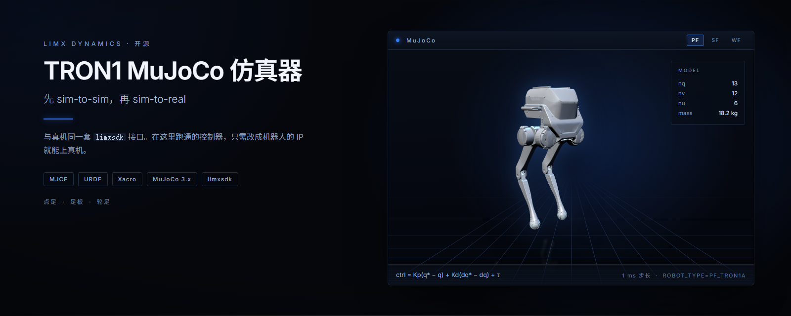
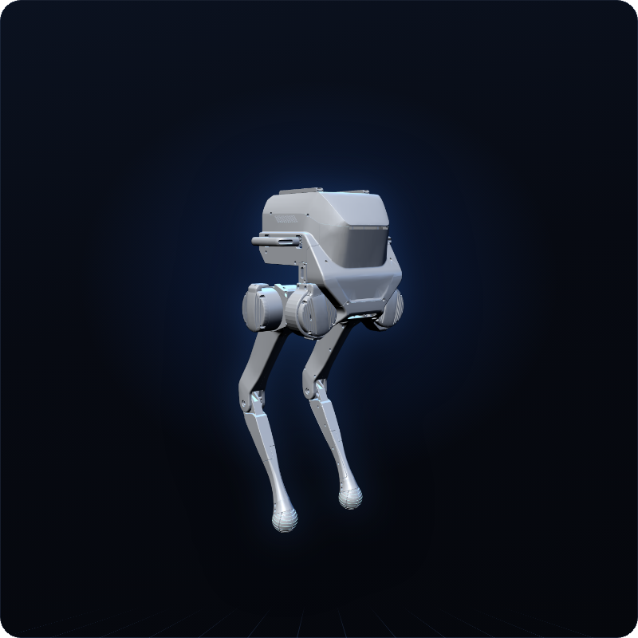
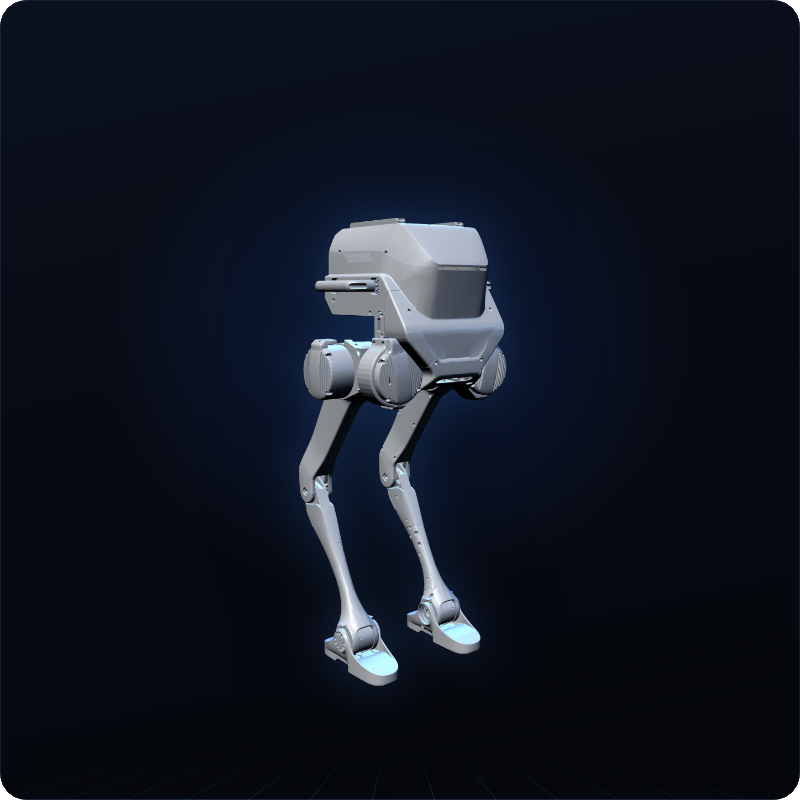
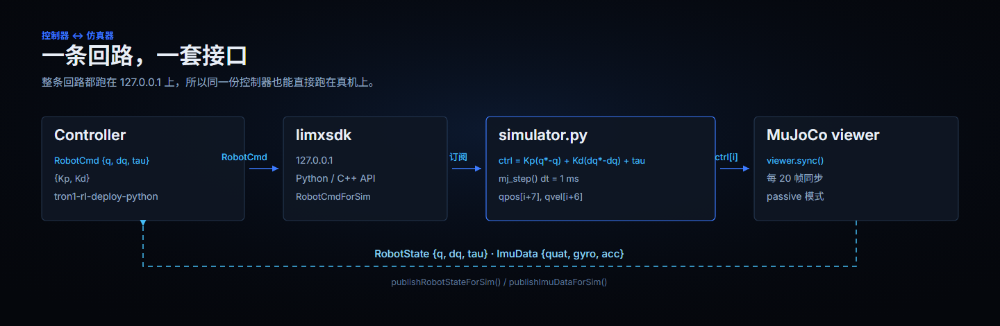
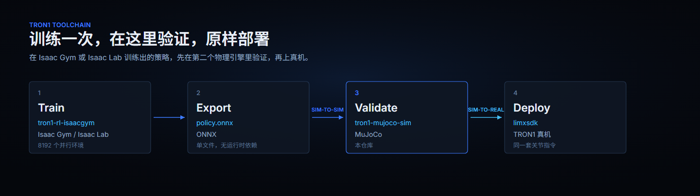
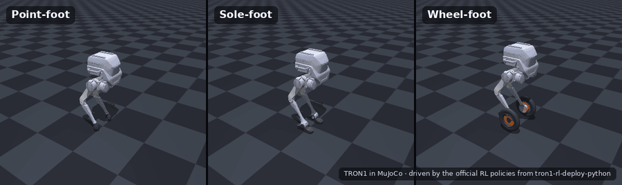

<p align="center">
  
</p>

<p align="center">
  <a href="README.md">English</a> | <b>中文</b>
</p>

<p align="center">
  <a href="LICENSE"></a>
  
  
  
</p>

# TRON1 MuJoCo 仿真器

在 MuJoCo 中运行 LimX TRON1 的官方控制器与 RL 策略，用的是和真机完全相同的
`limxsdk` 接口。控制器连 `127.0.0.1` 就是在驱动这个仿真器，连机器人的 IP 就是
在驱动机器人，代码一行都不用改。

**适用范围。** 本仓库负责仿真与验证控制器，不负责训练策略——训练在
[tron1-rl-isaacgym](https://github.com/limxdynamics/tron1-rl-isaacgym) 与
[tron1-rl-isaaclab](https://github.com/limxdynamics/tron1-rl-isaaclab)。

## 亮点

- **先 sim-to-sim，再 sim-to-real。** 在 Isaac Gym 或 Isaac Lab 训练出的策略，
  上真机前先在第二个物理引擎里再验一遍。
- **与真机接口互换。** 仿真器通过 `limxsdk` 发布 `RobotState` 与 `ImuData`、
  接收 `RobotCmd`，和 TRON1 真机一模一样。
- **十种配置，一条代码路径。** 六种点足、两种足板、两种轮足，含 TRON1B 型号，
  用 `ROBOT_TYPE` 切换。
- **控制到执行器层。** 每个关节都由 PD 律驱动，跑在 1 ms 的 MuJoCo 步长上，
  在这里调好的增益可以直接搬到真机。
- **自带键盘操控。** 配套的虚拟手柄不用游戏手柄也能让机器人行走和转向。

## 型号一览

下表中每张卡片都由
[robot-description](https://github.com/limxdynamics/tron1-robot-description)
里对应型号的 MJCF 渲染而来——也就是本仓库仿真的那个子模块。关节数与质量取自
编译后的 MuJoCo 模型（DOF 为主动关节数）。

| 渲染图 | 型号 | 说明 | DOF | 格式 |
|:--:|---|---|:--:|---|
|  | **点足**<br>`PF_TRON1A` | 球形足端，六个主动关节。调控制器时最常用的配置。 | 6 | MJCF / URDF / Xacro |
|  | **足板**<br>`SF_TRON1A` | 足板通过平行连杆踝关节连接，多两个踝关节用于平衡。 | 8 | MJCF / URDF / Xacro |
|  | **轮足**<br>`WF_TRON1A` | 用驱动轮代替足端。需要实时性足够的机器，见“常见问题”。 | 8 | MJCF / URDF / Xacro |

`ROBOT_TYPE` 用来选择配置。下表中每个取值都是 `robot-description/pointfoot/`
下的一个目录，仿真器从中加载 `<ROBOT_TYPE>/xml/robot.xml`。

| `ROBOT_TYPE` | 配置 | DOF | 质量 |
|---|:--:|:--:|--:|
| `PF_TRON1A`、`PF_TRON1B` | 点足 | 6 | 18.2 kg |
| `SF_TRON1A`、`SF_TRON1B` | 足板 | 8 | 20.8 kg |
| `WF_TRON1A`、`WF_TRON1B` | 轮足 | 8 | 22.3 kg |
| `PF_P441A` | 点足（P441） | 6 | 18.5 kg |
| `PF_P441B` | 点足（P441） | 6 | 17.2 kg |
| `PF_P441C`、`PF_P441C2` | 点足（P441） | 6 | 18.8 kg / 18.4 kg |

## 工作原理

仿真器是一个只负责物理循环的进程，你的控制器仍然是普通的 `limxsdk` 客户端，
所以同一个程序在这里能跑，在真机上也能跑。

<p align="center">
  
</p>

本仓库在 TRON1 工具链中的位置：

<p align="center">
  
</p>

## 30 秒快速开始：打开一个模型

模型都是标准 MJCF，任何系统上装了 MuJoCo 就能看，不需要 SDK、不需要 ROS、
不需要 Linux：

```bash
pip install mujoco
git clone --depth 1 https://github.com/limxdynamics/tron1-robot-description.git
python -m mujoco.viewer --mjcf=tron1-robot-description/pointfoot/PF_TRON1A/xml/robot.xml
```

此时没有任何控制器在控制它，机器人会倒在地上——这是正常现象，下一节接上控制器。

## 环境要求

- **Linux x86_64 或 aarch64。** 下面完整的仿真器流程是在这些平台上构建和测试的，
  不支持 macOS。
- **Python 3.8。** `limxsdk` 的 wheel 是 CPython 3.8 编译的——Linux 扩展链接
  `libpython3.8.so.1.0`，Windows 扩展链接 `python38.dll`——尽管两个文件的标签都是
  `py3-none-any`。装到更新的解释器上能装成功，但 `import` 会失败。
- MuJoCo 及其他 Python 依赖会随 `limxsdk` 一起安装。
- 虚拟手柄只有 x86_64 版本。

`limxsdk-lowlevel/python3/win` 里也有一个 `limxsdk-3.4.0` 的 wheel，
`robot-joystick` 也带了 `robot-joystick.exe`，都是 x86_64。下面的步骤不覆盖这两条
路径，且 Windows 版 wheel 比 Linux 版低一个小版本（3.4.0 / 3.4.2）。模型本身没有
这些限制——见上文的 30 秒快速开始。

## 在仿真器中运行 RL 策略

**1. 克隆仿真器和 RL 控制器**（必须带上子模块）：

```bash
git clone --recurse-submodules https://github.com/limxdynamics/tron1-mujoco-sim.git
git clone --recurse-submodules https://github.com/limxdynamics/tron1-rl-deploy-python.git
```

**2. 在虚拟环境中安装 `limxsdk`。** Ubuntu 23.04 及以后的版本不允许在虚拟环境外
直接 `pip install`（会报 `externally-managed-environment`）。

```bash
sudo apt install -y python3-venv      # 如果还没装 venv
python3 -m venv ~/tron1-venv
source ~/tron1-venv/bin/activate

# Linux x86_64
pip install tron1-mujoco-sim/limxsdk-lowlevel/python3/amd64/limxsdk-*.whl
# Linux aarch64
# pip install tron1-mujoco-sim/limxsdk-lowlevel/python3/aarch64/limxsdk-*.whl
```

**3. 启动仿真器**（终端 1）：

```bash
source ~/tron1-venv/bin/activate
export ROBOT_TYPE=PF_TRON1A           # 见“型号一览”
python tron1-mujoco-sim/simulator.py
```

机器人会马上倒下——这时还没有控制器在控制它。

**4. 启动 RL 控制器**（终端 2）：

```bash
source ~/tron1-venv/bin/activate
export ROBOT_TYPE=PF_TRON1A           # 必须与仿真器一致
export RL_TYPE=isaacgym               # 或 isaaclab
python tron1-rl-deploy-python/main.py
```

**5. 复位机器人：** 点击 MuJoCo 窗口，按 **Backspace**。机器人会在策略控制下站起来。

<p align="center">
  
  <br>
  <sub>点足、足板、轮足 TRON1 在 MuJoCo 中运行官方 RL 策略（离屏渲染，使用了自定义场景）。</sub>
</p>

## 用虚拟手柄操控

**6.** 在第三个终端：

```bash
./tron1-mujoco-sim/robot-joystick/robot-joystick
```

选中手柄窗口后，用**方向键**行走，用**小键盘 4 / 6** 转向。完整按键说明显示在
手柄窗口中。

<p align="center">
  
</p>

如果想永久设置 `ROBOT_TYPE`，把 `export` 那一行加到 `~/.bashrc` 中。

## 运行 C++ SDK 示例

`limxsdk-lowlevel` 子模块中带有 C++ 示例，同样通过 SDK 与仿真器通信。

```bash
sudo apt update
sudo apt install -y cmake build-essential libeigen3-dev

cd tron1-mujoco-sim/limxsdk-lowlevel
mkdir -p build && cd build
cmake .. && make

export ROBOT_TYPE=PF_TRON1A           # 与仿真器一致
./examples/pf_groupJoints_move
```

`pf_groupJoints_move` 是点足示例：把所有关节平滑地移动到零位，不负责平衡机器人。

## 使用自己的控制器

仿真器通过 `limxsdk` 连接 `127.0.0.1`。任何使用 `limxsdk` 订阅 `RobotState` /
`ImuData`、发布 `RobotCmd` 的控制器都可以接入。完整的 Python 示例见
[tron1-rl-deploy-python](https://github.com/limxdynamics/tron1-rl-deploy-python)，
C++ 示例见 [limxsdk-lowlevel](https://github.com/limxdynamics/limxsdk-lowlevel)。

## 常见问题

- **机器人一直躺在地上。** 先启动控制器，再在 MuJoCo 窗口中按 Backspace。
- **`error: externally-managed-environment`。** 按上文在虚拟环境中安装。
- **`Please set the ROBOT_TYPE`。** 每个终端（仿真器、控制器、SDK 示例）都需要
  `export ROBOT_TYPE=...`。
- **轮足在性能较弱的电脑或虚拟机上会倒。** 控制器按真实时间运行。如果仿真跑不到
  实时速度（例如在使用软件渲染的虚拟机中），轮足的平衡最先受影响，请使用支持
  GPU 加速 OpenGL 的电脑。

## 相关仓库

TRON1 的代码分散在多个仓库中，本仓库是其中的 sim-to-sim 这一步：

| 仓库 | 描述 |
|---|---|
| [tron1-rl-isaacgym](https://github.com/limxdynamics/tron1-rl-isaacgym) | 在 Isaac Gym 中训练 TRON1 RL 策略 |
| [tron1-rl-isaaclab](https://github.com/limxdynamics/tron1-rl-isaaclab) | 在 Isaac Lab 中训练 TRON1 RL 策略 |
| [tron1-rl-deploy-python](https://github.com/limxdynamics/tron1-rl-deploy-python) | 在本仿真器或真机上运行 RL 策略（Python，含预训练策略） |
| [tron1-rl-deploy-ros](https://github.com/limxdynamics/tron1-rl-deploy-ros) / [ros2](https://github.com/limxdynamics/tron1-rl-deploy-ros2) | 基于 ROS / ROS 2 运行 RL 策略 |
| [tron1-robot-description](https://github.com/limxdynamics/tron1-robot-description) | TRON1 URDF / MJCF 模型（子模块 `robot-description`） |
| [limxsdk-lowlevel](https://github.com/limxdynamics/limxsdk-lowlevel) | Python 与 C++ 底层 SDK（子模块） |
| [robot-joystick](https://github.com/limxdynamics/robot-joystick) | 虚拟手柄（子模块） |

TRON1 全部仓库与上手路线整理在 tron1-rl-isaacgym 的
[TRON1 开源生态](https://github.com/limxdynamics/tron1-rl-isaacgym/blob/master/README_cn.md#tron1-开源生态)
一节。

## 许可证

[Apache License 2.0](LICENSE)。附带组件说明见 [NOTICE](NOTICE)。

安全报告与贡献指南由组织统一维护：
[SECURITY.md](https://github.com/limxdynamics/.github/blob/main/SECURITY.md)、
[CONTRIBUTING.md](https://github.com/limxdynamics/.github/blob/main/CONTRIBUTING.md)。
